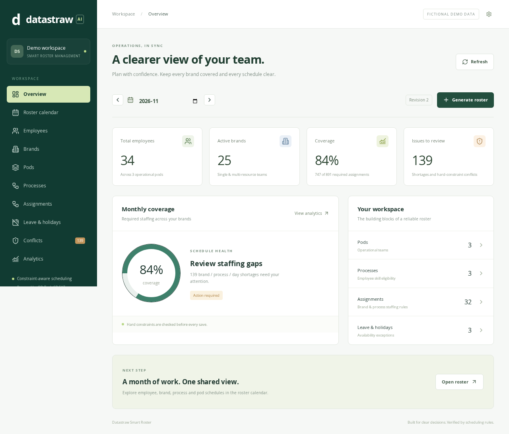
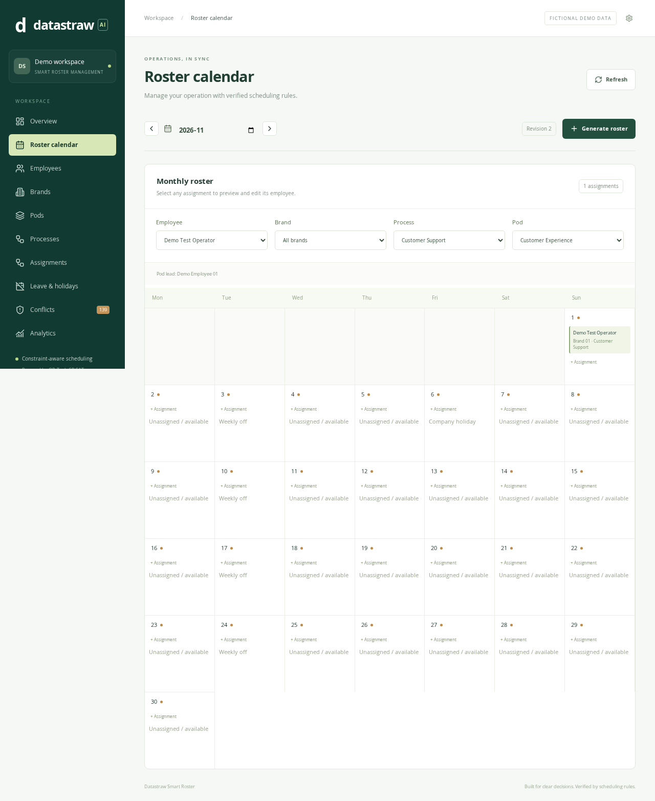

# Datastraw Smart Roster Management

A React + FastAPI assessment application for planning monthly staffing across brands, pods and processes. Candidate: **Mohit Vijay Wankhede**, AI + Tech Intern.

**Delivery status:** implemented and locally tested; not submission-ready. Hosted PostgreSQL setup, Vercel authorization/deployment, public demo video and signed-out LinkedIn accessibility verification remain open. See [handoff](docs/HANDOFF.md). No live URL is claimed.

## Problem and features

Manual schedules can double-book employees, overlook leave, or hide uncovered demand. This system separates employee eligibility, availability and operating calendars, maximizes coverage and exposes every remaining staffing shortage.

- Employee, brand, pod, process, demand/assignment, leave and holiday CRUD.
- Weekly off, active availability, skills, pod membership, pod leads and monthly work limits.
- Company holidays, brand-specific holidays, process calendars and weekday-specific staffing levels.
- CP-SAT monthly generation with coverage-first optimization, then workload balance.
- Saved rosters, optimistic revisions and transactional manual edits with impact preview.
- No double booking, no work on approved leave/off days, no unqualified allocation.
- Per-day shortage explanations; incomplete schedules are never marked valid.
- Calendar dashboard, employee/brand/process/pod views via filters, conflict monitor and analytics.
- 33 fictional employees, three pods, 25 brands, three processes and deliberate shortages.
- Optional shared admin token for mutations. Public read-only access remains possible.

Gemini is **not implemented**. Every reported scheduling result comes from deterministic code and CP-SAT.

## Stack and architecture

| Layer | Implementation |
|---|---|
| UI | React 19, TypeScript, Vite, Tailwind CSS 4, Lucide icons |
| HTTP | FastAPI and Pydantic |
| Scheduling | Google OR-Tools CP-SAT |
| Persistence | SQLAlchemy; PostgreSQL through psycopg; SQLite locally |
| Verification | Pytest, Vitest/Testing Library; Playwright workflow authored |
| Hosting target | Vercel only; Python API + static frontend |

Browser → `/api` → FastAPI router → validated services → SQLAlchemy transaction / scheduler → JSON → React.

- `app/models.py`: strict validated request records.
- `app/api.py`: CRUD, reference checks, roster generation/retrieval/edit/impact.
- `app/store.py`: database engine, schema, transactional workspace.
- `app/engine.py`: CP-SAT and independent schedule validation.
- `app/seed.py`: reproducible fictional workspace.
- `frontend/src/main.tsx`: management dashboard, calendar and editor.
- `app/main.py`, `app/scheduler.py`: retained stateless legacy prototype; new UI uses `/api` only.

## Scheduling algorithm

A Boolean variable represents an eligible `(date, employee, demand)` assignment. Ineligible variables are excluded before solving. A demand is one brand/process with a minimum staff count and explicitly assigned employees.

Hard constraints: at most one brand shift per employee/day, monthly work limit, correct pod and process eligibility, employee active status, approved leave, weekly off, operating weekdays, company and brand holidays. Demand allocations cannot exceed required staffing during generation.

Stage one maximizes filled staffing slots. When coverage optimality is proven, stage two fixes that coverage and minimizes the difference between maximum and minimum employee workload. Each solve uses one worker, seed zero, a deterministic search budget of two units and a ten-second wall-clock safety limit. `coverage_optimal` and `optimal` distinguish solver proof from feasible results. Tests demonstrate reproducibility on bounded examples; cross-version or timeout-limited output is not guaranteed identical. Pinned dependency snapshots are provided.

Unfilled coverage is a reported shortage, not a silently relaxed availability constraint. A roster is valid only if independent validation finds neither hard conflicts nor shortages. A feasible solver status is not proof that shortages are unavoidable; the UI does not label these results optimal. Reasons identify each assigned candidate's absence, eligibility, allocation and monthly work-limit blockers. Overlapping causes may appear together.

Manual changes run through the same validator. Invalid edits and edits that create or worsen any daily demand shortage are rejected with HTTP 409. Availability changes are allowed to reflect reality and return an impact report; retrieval always revalidates saved rosters against current configuration.

## Database design

The assessment implementation stores one versioned workspace as JSON in `roster_workspace(id, data)`. Collections contain employees, pods, processes, brands, demands, leaves, holidays and month-keyed rosters. Application checks enforce IDs, references and unique brand/process demands. PostgreSQL row locks serialize writes; roster revisions detect stale edits. Exceptions roll back transactions. SQLAlchemy JSON assignment writes a full copied workspace.

This deliberately compact design is **not a normalized enterprise schema**. It trades simpler atomic impact analysis for coarse locking and whole-document rewrites. SQLite does not provide the same concurrency guarantees. A production evolution should normalize entities, add database foreign keys, immutable audit snapshots, migrations and tenant isolation. The demo is sized for tens of employees, not thousands.

## API

Open `/docs` for generated OpenAPI documentation. New APIs:

| Method | Path | Behavior |
|---|---|---|
| GET | `/api/health` | Database readiness, scheduler and AI status |
| GET | `/api/data` | All configuration collections |
| POST | `/api/seed` | Seed an initialized empty database; refuses overwrite |
| GET / POST | `/api/{resource}` | List/create validated records |
| PUT / DELETE | `/api/{resource}/{id}` | Replace/delete; reject broken references |
| PUT | `/api/{resource}/{id}?preview=true` | Preview configuration impact without saving |
| POST | `/api/rosters/generate` | JSON `{ "year": 2026, "month": 11 }` |
| GET | `/api/rosters/{year}/{month}` | Saved roster, fresh validation and statistics |
| PUT | `/api/rosters/{year}/{month}` | JSON `{revision, slots, preview}` |
| GET | `/api/impact` | Revalidate every saved month |

Resources: `employees`, `brands`, `pods`, `processes`, `demands`, `leaves`, `holidays`.
Roster GET filters: `employee_id`, `brand_id`, `process_id`, `pod_id`. Workload and coverage statistics describe the whole month, while returned slots reflect filters. No pagination or per-user authorization is implemented. IDs are manually assigned and shown in the UI. Weekdays: Monday 0 to Sunday 6.

## Local setup

Use Python 3.12 and Node 22/24.

```bash
python -m venv .venv
# Linux/macOS
source .venv/bin/activate
# Windows PowerShell: .venv\Scripts\Activate.ps1
pip install -r requirements-lock.txt
# DATABASE_URL optional locally; default SQLite roster.db
python -m app.seed
python -m uvicorn app.main:app --reload --port 8000
```

In another terminal:

```bash
cd frontend
npm ci
npm run dev -- --host 127.0.0.1
```

Open `http://127.0.0.1:5173`. November 2026 contains the seeded leave/holiday examples. Seeding refuses to overwrite existing data. For an empty schema without seed: `python -c "from app.store import initialize; initialize()"`.

## Environment variables

See `.env.example`. Export variables in the shell; the application does not auto-load `.env` files.

| Name | Purpose |
|---|---|
| `DATABASE_URL` | PostgreSQL pooled connection URI with `sslmode=require`; mandatory on Vercel |
| `ADMIN_TOKEN` | Optional shared write credential; enter in Workspace settings for the current browser session |

Never put database or admin secrets in frontend `VITE_*` variables, Git or screenshots. Without ADMIN_TOKEN the demo permits public mutations; use fictional data and consider a private token while preparing the assessment.

## Testing and build

```bash
pip install -r requirements-dev.txt
python -m pytest -q
cd frontend
npm ci
npm test
npm run build
# From frontend: install the browser
npx playwright install chromium
cd ..
# Starts both servers and uses an isolated disposable database
python scripts/run_e2e.py
```

Verified in this environment: **22 Pytest tests and 5 Vitest tests passed**, TypeScript/Vite build passed, production npm dependency audit reported zero vulnerabilities. One Playwright browser workflow passed against an isolated local database after an alternative Chromium runtime was configured. It verifies employee creation, eligibility, availability changes, generation, invalid-edit rejection, valid save and persistence after reload. Desktop/mobile screenshots were captured and inspected. No hosted PostgreSQL, production API or deployment pass is claimed. See [test summary](docs/TEST_SUMMARY.md).

## Vercel deployment

See [deployment runbook](docs/DEPLOYMENT.md). `vercel.json` builds `api/index.py` using `@vercel/python` and `frontend/package.json` using `@vercel/static-build`. Routing places `/api`, `/docs` and `/openapi.json` before static SPA fallback. All app hosting stays on Vercel; Neon or another managed PostgreSQL provider is database-only.

A Vercel project has been created and associated with this repository. Team authorization and DATABASE_URL setup are pending. The GitHub update triggered an automatic Vercel deployment, which failed; its logs require team authorization. The cause has not been diagnosed, and there is no verified live deployment. Vercel Python supports the target Python version and native wheels; OR-Tools installed and tests ran on local Python 3.12. Installed package size, production cold starts, serverless duration and memory still require a real Vercel build and runtime verification. Two solver stages have a combined 20-second wall-clock bound, apart from imports, validation and database work.

## Limitations and future improvements

- The original seven-page PDF was retrieved from the Datastraw assessment email and reviewed; remaining verification is tracked in docs/ACCEPTANCE.md.
- One full-day allocation per employee; no time-of-day shifts or multi-shift capacity.
- Shared-token demo security, no user accounts/RBAC, no audit log or tenant isolation.
- Single workspace JSON row; no schema migrations or normalized database constraints.
- Saved results use current configuration on retrieval; no immutable historical master-data snapshot.
- A local browser workflow and desktop/mobile screenshot inspection passed; a comprehensive accessibility audit and production browser checks remain pending.
- No Gemini, sent submission email, hosted demo video or verified production URL.
- Fairness is constrained by assigned eligibility pools; a balanced global workload is not always possible.
- Legacy prototype endpoints remain for compatibility and are not persistent management APIs.

Next: normalize persistence, add audited roster versions, shift intervals, background jobs for larger instances, coverage-specific staffing recommendations, pagination and verified optional Gemini explanations.

## Submission and learning materials

- [Technical approach](docs/TECHNICAL_APPROACH.md)
- [Acceptance checklist](docs/ACCEPTANCE.md)
- [Demo script and recording sequence](docs/DEMO_SCRIPT.md)
- [Submission email draft](docs/SUBMISSION_EMAIL.md) — do not send before explicit candidate approval
- [Interview preparation](docs/INTERVIEW_PREPARATION.md)
- [Final handoff and remaining actions](docs/HANDOFF.md)

## Tell us how you think — assessment questions

1. **How are entities modeled?** Employees belong to pods and hold process skills. Pods optionally reference a lead from their own team. A brand belongs to a pod. A demand connects a brand/process to eligible employees, operating rules and staffing counts. Approved absence records represent leave, comp-offs or unavailability. Saved rosters reference these IDs.
2. **How is a valid roster generated?** CP-SAT excludes unavailable/ineligible options, constrains brand shifts and monthly work limits, then maximizes coverage before fairness. A separate validator checks the returned slots. Both shortages and hard violations make `valid=false`.
3. **Single versus multiple resources?** The data model is the same: a demand has one or several employees. Twenty of 25 seeded brands have one dedicated employee. The other five have two or three employees across separate and overlapping processes. A qualified employee may handle multiple compatible processes in one daily brand shift.
4. **What if the dedicated employee is absent?** Approved absence is respected. Every affected required brand/process/day is reported short. A manager must assign a qualified backup or explicitly revise demand; the system never invents availability.
5. **Conflicts or insufficient staffing?** Candidate blockers and exact missing counts are shown. Hard rules are never bypassed. A feasible solver result is distinguished from proven optimal coverage. Manual changes that violate rules or worsen shortages are rejected.
6. **Automation versus human control?** Validation, impact analysis, coverage allocation and workload optimization are automated. Managers control master data, eligibility, approved absences, operational rules and final acceptance. Unexpected real-world changes should not silently publish a new roster.
7. **What if scale doubles?** Benchmark realistic data, normalize persistence with database constraints and indexes, add audit snapshots, paginate endpoints and assess whether generation needs a job workflow. The current workspace row is a deliberate assessment-scale trade-off.
8. **What would one extra week improve?** Complete production/normalized persistence, audit history and accessible rule-entry forms first. Then add qualified-backup suggestions and only consider optional AI explanations after correctness is established.

### Explicit scheduling assumptions

A daily shift belongs to one brand. Several process responsibilities within that brand are compatible when the employee has each required skill and is assigned to each demand; the sample models those as a bundled shift with one workload day. Different-brand shifts on the same day are incompatible. The model has no hourly capacity or process-duration estimates, so this assumption must be validated with an operations manager before real use. Brand calendars are outer closure rules; process calendars can add closures, not reopen a brand. Staffing vectors have seven values, Monday through Sunday. Approved weekly offs and absences are mandatory; optional preferred offs are not modeled. Employee calendars explicitly show weekly off, leave/comp-off, company holiday or unassigned/available when no slot is present.

## Screenshots

Captured during local browser acceptance; the extra test employee makes the displayed total 34.





[Mobile dashboard screenshot](docs/dashboard-mobile.png)
